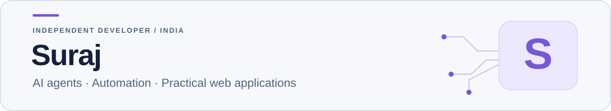

<picture>
  <source media="(prefers-color-scheme: dark)" srcset="https://raw.githubusercontent.com/surajns0033-collab/surajns0033-collab/main/assets/profile-header-dark.svg" />
  <source media="(prefers-color-scheme: light)" srcset="https://raw.githubusercontent.com/surajns0033-collab/surajns0033-collab/main/assets/profile-header.svg" />
  
</picture>

  <code>TypeScript</code>
  <code>JavaScript</code>
  <code>Python</code>
  <code>Next.js</code>
  <code>AI Agents</code>
  <code>Automation</code>

  <a href="mailto:suraj.n.srivastav@gmail.com"><strong>Discuss a project →</strong></a>
  &nbsp; · &nbsp;
  <a href="https://github.com/sponsors/surajns0033-collab"><strong>Sponsor my work →</strong></a>

## About Me

I'm an independent developer based in India, focused on turning ideas into useful, open-source software. My interests span artificial intelligence, AI agents, developer tools, automation, project management, and digital innovation.

I enjoy experimenting with emerging technologies and building practical applications that solve everyday problems.

## Featured Work

<table width="100%">
  <tr>
    <td width="50%" valign="top">
      
01 · DIGITAL TWINS &amp; OPERATIONS

      <h3>AI Stadium OS</h3>
      
A stadium operations platform combining digital twin views, crowd monitoring, incident workflows, and scenario simulations.

      
<code>Next.js</code> <code>TypeScript</code> <code>AI</code>

      
<a href="https://github.com/surajns0033-collab/ai-stadium-os-fifa2026"><strong>View code →</strong></a> &nbsp;·&nbsp; <a href="https://ai-stadium-os.vercel.app">Live demo →</a>

    </td>
    <td width="50%" valign="top">
      
02 · TOOLS FOR FREELANCERS

      <h3>InvoiceSort</h3>
      
A receipt sorter that reads photos, categorizes expenses, and exports CSV. Receipt files stay on the device.

      
<code>JavaScript</code> <code>OCR</code> <code>Local AI</code>

      
<a href="https://github.com/surajns0033-collab/invoicesort"><strong>View code →</strong></a> &nbsp;·&nbsp; <a href="https://surajns0033-collab.github.io/invoicesort/">Live demo →</a>

    </td>
  </tr>
  <tr>
    <td width="50%" valign="top">
      
03 · PLANNING &amp; AUTOMATION

      <h3>Marigold</h3>
      
A celebration planner that turns event details into a budget, timeline, vendor checklist, and task plan.

      
<code>JavaScript</code> <code>Planning</code> <code>GenAI</code>

      
<a href="https://github.com/surajns0033-collab/marigold-celebration-planner"><strong>View code →</strong></a> &nbsp;·&nbsp; <a href="https://marigold-celebration-planner.vercel.app">Live demo →</a>

    </td>
    <td width="50%" valign="top">
      
04 · LEARNING WITH LOCAL AI

      <h3>LinguaPal</h3>
      
A language tutor with conversation practice, gentle corrections, vocabulary flashcards, and spaced repetition.

      
<code>Python</code> <code>FastAPI</code> <code>Local AI</code>

      
<a href="https://github.com/surajns0033-collab/linguapal"><strong>View code →</strong></a>

    </td>
  </tr>
</table>

## Contribution Arcade 🐍 🟡

  <picture>
    <source media="(prefers-color-scheme: dark)" srcset="https://raw.githubusercontent.com/surajns0033-collab/surajns0033-collab/output/github-contribution-grid-snake-dark.svg?v=arcade-4" />
    <source media="(prefers-color-scheme: light)" srcset="https://raw.githubusercontent.com/surajns0033-collab/surajns0033-collab/output/github-contribution-grid-snake.svg?v=arcade-4" />
    
  </picture>

## What Your Sponsorship Supports

Your sponsorship gives me more time to build useful tools, maintain open-source projects, and share what I learn.

Your support helps me:

- Build and maintain open-source projects.
- Develop AI-powered tools and applications.
- Explore innovative technologies and automation.
- Improve documentation, features, and project quality.
- Dedicate more time to community-driven development.

Every contribution, no matter the size, motivates me to keep building and sharing.

**Thank you for supporting independent development and open source!**

<a href="https://github.com/sponsors/surajns0033-collab"><strong>Support my open-source work →</strong></a>
